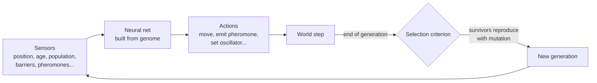

<div align="center">

# 🧬 evolution-simulator

**A neural-net creature simulator where behavior evolves through natural selection.**

[](https://github.com/TuxLux40/evolution-simulator/actions/workflows/main.yml)


[](LICENSE)

[Quick start](#-quick-start) · [Web app](#-web-app) · [How it works](#-how-it-works) · [Configuration](#%EF%B8%8F-configuration) · [Output](#-output) · [Tools](#-tools) · [Tests](#-tests)

</div>

---

This repository is a fork of [davidrmiller/biosim4](https://github.com/davidrmiller/biosim4). The
C++ executable is still called `biosim4`, and all simulator code lives in the `BS` namespace.

A population of creatures lives on a 2D grid. Each creature has a genome that is wired into a small
neural-net brain. Every generation, only the creatures that meet a selection criterion get to
reproduce, with mutation and recombination. Over many generations, behaviors emerge.

The original results are summarized in the video
[**"I programmed some creatures. They evolved."**](https://www.youtube.com/watch?v=N3tRFayqVtk)

> [!NOTE]
> Upstream is in maintenance-only mode. Bug fixes that keep the program compiling and running are
> welcome. For a nicer GUI, see [ilyabrilev/biosim4](https://github.com/ilyabrilev/biosim4).

## 🚀 Quick start

The easiest route is Docker, which is also what CI uses.

```sh
# 1. Build the toolchain image (once)
docker build -t biosim4 .

# 2. Compile into ./bin
docker run --rm -ti -v `pwd`:/app --name biosim biosim4 make

# 3. Run with the default config
docker run --rm -ti -v `pwd`:/app --name biosim biosim4 ./bin/Release/biosim4 biosim4.ini
```

You should see output like `Gen 1, 2290 survivors`. Movies, logs and plots appear under `images/` and `logs/`.

To get a shell in the container instead (handy for running the tools and tests), replace the last
command with `... biosim4 bash`. Exit with `Ctrl-D`. Everything written to the mounted directory persists.

**Native build:** see [Building](#-building).

## 🌐 Web app

[`webapp/`](webapp/) is a browser-based reimplementation of the simulator in TypeScript and React. It
needs no server and no C++ toolchain. You can tune the world and genetics from a control panel, watch every
creature move live on a canvas, inspect and edit a creature's neural net, and switch neural-net evaluation
between a CPU and a WebGPU compute backend.

```sh
cd webapp
npm install
npm run dev      # dev server with hot reload
npm run build    # type-check and build a static dist/
```

See [`webapp/README.md`](webapp/README.md) for features and the deliberate differences from the C++ version.

## 🧠 How it works



Each creature's brain wires sensory input neurons through optional internal neurons to action output
neurons. The sensors and actions are described in the video above and enumerated in
[`src/sensors-actions.h`](src/sensors-actions.h).

### Main data structures

| Piece | Files | Role |
|---|---|---|
| `Grid` | `grid.h/.cpp` | 2D array of 16-bit indexes. `0` means empty, any other value indexes into `Peeps`. It knows nothing else about the world. |
| `Peeps` | `peeps.h/.cpp` | The population: a `std::vector` of `Indiv`. |
| `Indiv` | `indiv.h/.cpp` | One creature: genome, neural-net brain, X,Y location, and personal parameters (responsiveness, oscillator period, age). It converts its genome to a brain, computes its inputs in `Indiv::getSensor()`, and prints its genome and net as text. |
| `Signals` | `signals.h/.cpp` | A pheromone layer that overlays the grid. |
| `ParamManager` | `params.h/.cpp` | Reads `biosim4.ini` and watches it for changes. |

### Main program loop

`simulator()` in [`simulator.cpp`](src/simulator.cpp) runs three nested loops:

1. **Generation:** each generation ends with `endOfGeneration()`, which builds the movie from the saved frames and may update the graph.
2. **Simulation step:** each step ends with the single-threaded `endOfSimStep()`, which renders a video frame.
3. **Individual:** the innermost loop is thread-safe and parallelized with OpenMP.

### Sensors and actions

Enable or disable neurons by moving enumerants relative to the `NUM_SENSES` and `NUM_ACTIONS` markers in
[`sensors-actions.h`](src/sensors-actions.h). Anything after a marker is compiled out. If you add
items, also update the name functions in [`analysis.cpp`](src/analysis.cpp).

<details>
<summary><b>Sensors</b> (21 active)</summary>

| Sensor | Meaning |
|---|---|
| `LOC_X`, `LOC_Y` | Position in the world |
| `BOUNDARY_DIST`, `_X`, `_Y` | Distance to the nearest edge |
| `GENETIC_SIM_FWD` | Genetic similarity of the neighbor ahead |
| `LAST_MOVE_DIR_X`, `_Y` | Direction of the last movement |
| `LONGPROBE_POP_FWD`, `LONGPROBE_BAR_FWD` | Long look ahead for population or barriers |
| `POPULATION`, `_FWD`, `_LR` | Population density nearby, along the forward axis, and along the left-right axis |
| `BARRIER_FWD`, `BARRIER_LR` | Neighborhood barrier distance |
| `OSC1` | Internal oscillator |
| `AGE` | Age in steps |
| `RANDOM` | Uniform random value |
| `SIGNAL0`, `_FWD`, `_LR` | Pheromone strength nearby, along the forward axis, and along the left-right axis |

</details>

<details>
<summary><b>Actions</b> (16 active, plus <code>KILL_FORWARD</code> which is disabled by default)</summary>

| Action | Meaning |
|---|---|
| `MOVE_X`, `MOVE_Y` | Signed X or Y movement |
| `MOVE_FORWARD`, `MOVE_REVERSE` | Continue or reverse the last direction |
| `MOVE_RL`, `MOVE_LEFT`, `MOVE_RIGHT` | Move relative to heading |
| `MOVE_EAST/WEST/NORTH/SOUTH` | Compass movement |
| `MOVE_RANDOM` | Random step |
| `SET_OSCILLATOR_PERIOD` | Tune the internal oscillator |
| `SET_LONGPROBE_DIST` | Tune the long-probe distance |
| `SET_RESPONSIVENESS` | Scale how strongly outputs trigger movement |
| `EMIT_SIGNAL0` | Emit pheromone |
| `KILL_FORWARD` | Kill the neighbor ahead (off unless moved before `NUM_ACTIONS`) |

</details>

### Basic value types

| Type | Description |
|---|---|
| `enum Compass` | Eight-way directions plus `CENTER`: `N, NE, E, SE, S, SW, W, NW, CENTER` |
| `struct Dir` | Abstract representation of `Compass` values |
| `struct Coord` | Signed 16-bit X,Y pair: a location or a difference between locations |
| `struct Polar` | Signed 32-bit magnitude plus a `Dir` |

Conversions and math between these types are in [`basicTypes.h`](src/basicTypes.h) and exercised in
`unitTestBasicTypes.cpp`.

### Pheromones

Pheromones are called *signals* in the code. `Signals` holds one layer over the grid (there is currently a
single pheromone kind). Each cell stores a `uint8_t`, where `0` is none and `255` is the maximum. An
individual that emits a pheromone raises the values in a small neighborhood around itself to `255`. Levels
decay over time unless replenished.

### Utility: `visitNeighborhood()`

`visitNeighborhood()` in [`grid.cpp`](src/grid.cpp) runs a lambda over every in-bounds grid cell within a
circular neighborhood (center point plus floating-point radius). The center is included. A radius of `1.0`
visits the center and its 4 neighbors, and `1.5` visits the center and all 8 neighbors. Large radii cost a lot of CPU.

## 🔨 Building

### Requirements

Upstream tested the code on:

- Ubuntu 21.04 / 22.04 or Debian 10, with gcc 8.3 to 10.3
- `cimg-dev` ≥ 2.4.5 and `libopencv-dev` ≥ 3.2 (movies)
- `python3-igraph` (only for `tools/graph-nnet.py`)
- `gnuplot` (only for `tools/graphlog.gp`)

The [Dockerfile](Dockerfile) installs all of these on `ubuntu:latest`, and its `darwin` user avoids root-owned build output.

### Pick a build system

<table>
<tr><th>Makefile</th><th>CMake</th><th>Code::Blocks</th></tr>
<tr valign="top">
<td>

```sh
make            # debug + release
make release    # ./bin/Release
make debug      # ./bin/Debug
make clean
make distclean  # also logs/* images/*
```

C++17, `-fopenmp`, OpenCV via `pkg-config opencv4`.

</td>
<td>

```sh
mkdir build && cd build
cmake ../
cmake --build ./

# test install
mkdir test_install
cmake --install ./ --prefix ./test_install
cd test_install && ./bin/biosim4

# package
cpack ./
```

</td>
<td>

Open `biosim4.cbp` (Code::Blocks 20.03).

</td>
</tr>
</table>

The installed CMake layout includes `biosim4.ini`, `tools/`, and empty `logs/` and `images/` directories.

### Ubuntu 20.04 and CImg

The `cimg-dev` package on Ubuntu 20.04 has a [known bug](https://bugs.debian.org/cgi-bin/bugreport.cgi?bug=951965).
CImg is used only as an interface to OpenCV for writing movies. Options:

- Strip the movie code (mostly `imageWriter.cpp` and `imageWriter.h`) and run without movies.
- Install the Ubuntu 22.04 `cimg-dev` (≥ 2.8.4):
  ```sh
  cd /tmp && \
  wget http://mirrors.kernel.org/ubuntu/pool/universe/c/cimg/cimg-dev_2.9.4+dfsg-3_all.deb && \
  sudo apt install ./cimg-dev_2.9.4+dfsg-3_all.deb && \
  rm cimg-dev_2.9.4+dfsg-3_all.deb
  ```
- Port the CImg calls to OpenCV directly.

## ▶️ Running

```sh
./bin/Release/biosim4 [biosim4.ini]
```

The config path is optional and defaults to `biosim4.ini`. If the file is missing, hardcoded defaults
matching the shipped `biosim4.ini` are used.

## ⚙️ Configuration

[`biosim4.ini`](biosim4.ini) holds every tunable parameter and documents each one inline. The simulator
re-reads it while running, so many parameters can be changed mid-run. Parameters map to `struct Params` in
[`params.h`](src/params.h), which also explains how to add new ones.

Some knobs worth knowing:

| Parameter | Default | What it does |
|---|---|---|
| `population` | `3000` | Number of creatures |
| `sizeX` / `sizeY` | `128` | World dimensions |
| `stepsPerGeneration` | `300` | Steps per generation |
| `maxGenerations` | `200000` | When to stop |
| `numThreads` | `4` | OpenMP threads |
| `challenge` | `6` | Selection criterion (see below) |
| `barrierType` | `0` | Obstacle layout (see below) |
| `deterministic` | `false` | Seeded RNG for reproducible runs |
| `saveVideo` / `videoStride` | `true` / `25` | Make a movie every N generations |

Parameters can also be scheduled by generation, e.g. `barrierType@500 = 5`.

<details>
<summary><b>Selection challenges</b> (<code>challenge</code>, see <code>survival-criteria.cpp</code>)</summary>

| # | Criterion | # | Criterion |
|---|---|---|---|
| 0 | circle | 10 | radioactive walls |
| 1 | right half | 11 | against any wall |
| 2 | right quarter | 12 | touch any wall any time |
| 3 | neighbor count | 13 | east-west eighths |
| 4 | center weighted | 14 | near barrier |
| 40 | center unweighted | 15 | pairs |
| 5 | corner 1/4 radius | 16 | contact location sequence |
| 6 | corner 1/4 radius weighted | 17 | altruism, circle + NE corner |
| 7 | migrate distance | 8 | center sparse |
| 9 | left eighth | | |

</details>

<details>
<summary><b>Barrier types</b> (<code>barrierType</code>, see <code>createBarrier.cpp</code>)</summary>

`0` none · `1` vertical bar, constant location · `2` vertical bar, random locations · `3` five staggered vertical bars · `4` horizontal bar, north center · `5` floating islands · `6` sequence of spots

</details>

## 📈 Output

Depending on the config, a run produces:

| Output | Where | Notes |
|---|---|---|
| Epoch log | `logs/epoch-log.txt` | One line per generation: generation, survivors, genetic diversity estimate, average genome length, deaths from the "kill" gene. |
| Sample genomes | stdout | Hex plus a mnemonic format that `tools/graph-nnet.py` can draw. Count and interval are set in the config. |
| Movies | `images/` | One movie per selected generation, at the configured interval. |
| Connection summary | stdout | Totals of neural connections from each sensor and to each action across the population. |

## 🛠️ Tools

| Tool | Purpose |
|---|---|
| [`tools/graphlog.gp`](tools/graphlog.gp) | gnuplot script that turns `logs/epoch-log.txt` into `images/log.png`. The simulator runs it automatically when `updateGraphLog = true` (see `updateGraphLogStride`). |
| [`tools/graphlog-genomeLength.gp`](tools/graphlog-genomeLength.gp) | Variant that also plots genome length. Edit the hardcoded log path first. |
| [`tools/graph-nnet.py`](tools/graph-nnet.py) | Draws a neural-net diagram with igraph from a genome saved as `net.txt` (written to `net.svg`). |

```sh
gnuplot tools/graphlog.gp
cd tools && python3 graph-nnet.py
```

To use `graph-nnet.py`, copy one genome from the `displaySampleGenomes` stdout output into `tools/net.txt`.
Adjust paths in the `.gp` scripts if they don't match your environment.

## ✅ Tests

[`tests/testapp.py`](tests/testapp.py) runs a full simulation and checks the outcome against expected
ranges stored in [`tests/configs/testapp.ini`](tests/configs/testapp.ini). It runs `./bin/Release/biosim4`,
so do a release build first, and always run it from inside `tests/`.

```sh
cd tests
python3 testapp.py --show              # list configured tests
python3 testapp.py --test microtest    # quick sample run
python3 testapp.py --help
```

See [`tests/README.md`](tests/README.md) for adding tests. There are also compiled-in unit tests
(`src/unitTest*.cpp`) for basic types, neural wiring from genome, and neighborhood visiting.

## 🗂️ Repository layout

```
.
├── src/            simulator source (builds to the `biosim4` executable)
├── webapp/         browser version (TypeScript + React, Vite)
├── tools/          gnuplot and igraph helpers
├── tests/          testapp.py harness and test configs
├── biosim4.ini     default configuration
├── Makefile        debug and release builds
├── CMakeLists.txt  CMake build, install and CPack
├── biosim4.cbp     Code::Blocks project
├── Dockerfile      build/run environment
├── bin/            build output (Debug/, Release/)
├── logs/ images/   run output
└── .github/        CI: build and compile inside Docker
```

## 📄 License

[MIT](LICENSE). Copyright © 2021–2022 David R. Miller and other contributors.
